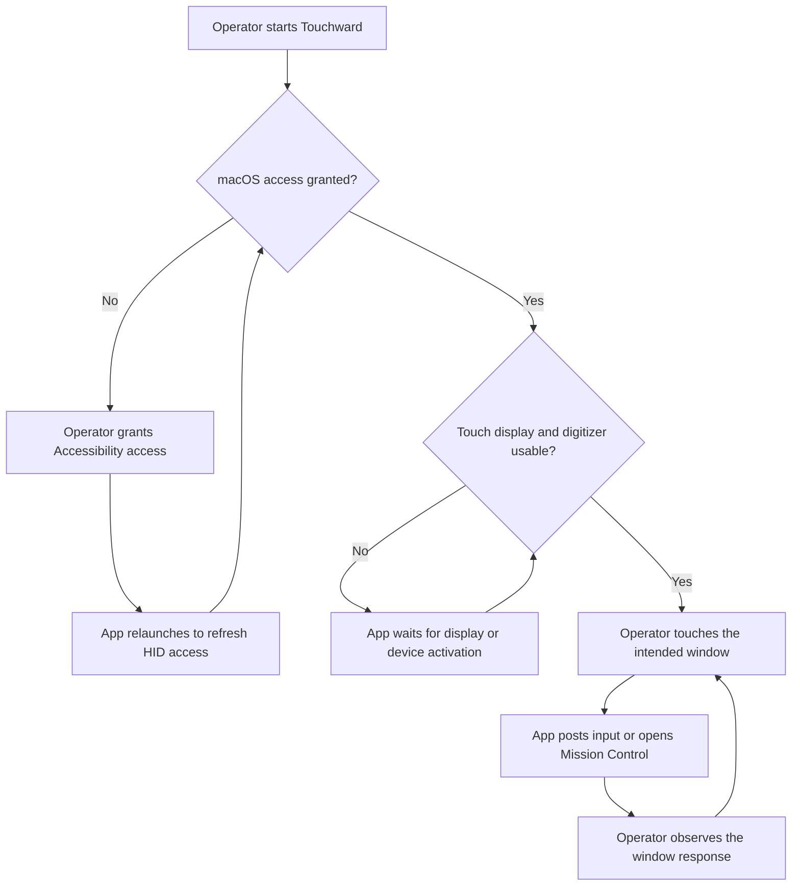

# Touchward Primary Journey

## Scope

The custom app's activation and interaction path, checked against `main.swift` and
`EventSynthesizer.swift`. With the keyboard preference disabled, focusing a text field
does not construct or show the panel; the physical keyboard remains available. Desktop
swipes use macOS Control-arrow shortcuts; two-finger double-tap opens the native Mission
Control app. This is a user journey, not a detailed gesture algorithm or a claim of
hardware acceptance.

## Legend

Rectangles are operator or app actions; diamonds are readiness checks. Arrow labels name
the branch taken. A return arrow means the app continues waiting or processing.

## Assumptions

The Mac already displays the intended window on the panel. The app has selected the
correct display. The operator can use the physical keyboard while touch is being set up.

## Open Questions

On October 23, renewing the installed 1.0.2 app's stale Accessibility signature restored
touch access, and Edward confirmed one-finger scrolling. The 1.0.4 working-tree update
adds two-finger scrolling and three-finger desktop swipes while retaining two-finger
double-tap Mission Control. Edward confirmed two-finger scrolling and three-finger
left/right desktop switching on the installed build after access renewal. Other gesture
acceptance remains separate from automated tests; see current state.

## Accessible Description

The operator starts the app. If permission is missing, macOS settings and an app relaunch
establish access. The app then waits for a usable display and digitizer. Touches produce
input in macOS, and the operator verifies the visible response. A working process alone
does not establish that the desired gesture feels or behaves correctly.
